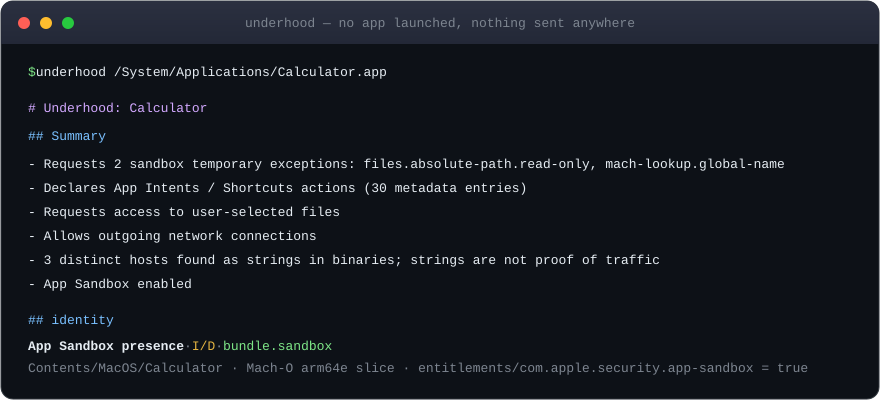
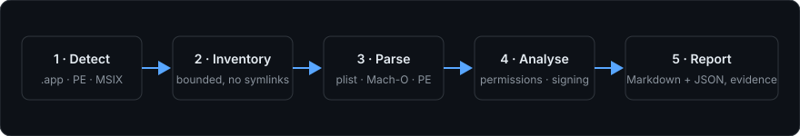

<div align="center">

# Underhood

### Look under the hood of any app, without running it.

**Offline static analyzer for macOS apps and Windows executables.** Entitlements, privacy permissions, code signing, URL schemes, launch items, MSIX capabilities and network endpoint strings, with evidence for every claim.

[](LICENSE)
[](go.mod)
[](https://github.com/harinaralasetty/underhood/actions/workflows/ci.yml)
[](https://github.com/harinaralasetty/underhood/releases/latest)


[**Quick start**](#quick-start) · [What it finds](#what-it-finds) · [Targets](#what-you-can-analyse) · [How it works](#how-it-works) · [Sample reports](#sample-reports) · [FAQ](#faq) · [Docs](#documentation)

```sh
go install github.com/harinaralasetty/underhood/cmd/underhood@latest
```



</div>

> [!NOTE]
> A declared capability or a string in a binary is **not** observed runtime behaviour. Underhood tells you what an app says it can do and where it says it, so you know where to look next.

## Why Underhood

You want to know what an app is allowed to touch before you trust it, and you do not want to launch it to find out.

- **Nothing runs.** It reads files. It never executes the target or its bundled binaries, spawns no subprocesses and makes no network calls.
- **Every claim has evidence.** Each finding cites the file and locator it came from, so you can check it yourself.
- **One static binary.** Pure Go standard library, no external modules, no Apple command-line tools, no Windows runtime.
- **Cross-platform.** Runs on macOS, Linux and Windows, and can inspect macOS and Windows targets from any of them.
- **Deterministic.** Output is sorted and merged the same way every time; only `scannedAt` varies.
- **Human and machine output.** Readable Markdown by default, schema-versioned JSON for scripts and agents.

## Quick start

**Install** with Homebrew on macOS or Linux:

```sh
brew install harinaralasetty/tap/underhood
```

or with Go 1.22+:

```sh
go install github.com/harinaralasetty/underhood/cmd/underhood@latest
```

or download a prebuilt binary, no Go needed. [Releases](https://github.com/harinaralasetty/underhood/releases/latest) has archives for macOS, Linux and Windows on amd64 and arm64, with `checksums.txt`. For example, on an Apple silicon Mac:

```sh
curl -LO https://github.com/harinaralasetty/underhood/releases/download/v0.1.0/underhood_0.1.0_darwin_arm64.tar.gz
tar -xzf underhood_0.1.0_darwin_arm64.tar.gz
./underhood_0.1.0_darwin_arm64/underhood --version
```

The binaries are not signed or notarized. If macOS blocks one you downloaded in a browser, run `xattr -d com.apple.quarantine <path to underhood>`.

or build from source:

```sh
git clone https://github.com/harinaralasetty/underhood.git
cd underhood
CGO_ENABLED=0 go build -o underhood ./cmd/underhood
./underhood --help
```

**Inspect** something:

```sh
underhood /System/Applications/Calculator.app                       # Markdown to stdout
underhood ./launcher.exe --format both --output launcher-report     # launcher-report.md + .json
underhood ./application.msix --format json                          # JSON only
underhood /System/Applications/Notes.app --full --output notes.md   # every evidence entry
```

Windows files can be inspected from macOS or Linux. A macOS app bundle must be available locally, and its layout preserved if you copy it between hosts.

<details>
<summary><b>Flags, exit codes and output rules</b></summary>

<br>

- `--format md|json|both`: Markdown goes to stdout by default. `both` requires `--output <base>` and writes `<base>.md` and `<base>.json`.
- `--full`: list every evidence entry and description. JSON always retains all findings and retained evidence.
- `--no-binary-strings`: skip endpoint scanning. `--max-binary-mb <n>`: change the per-binary scan bound (default 300 MiB).
- Flags may come before or after the target; `--` ends option parsing.
- Exit codes: **0** report produced (including documented skips), **1** usage or output error, **2** invalid or unsupported target.
- Output parents must exist. Existing regular files outside the target and system directories are replaced atomically via a temporary file in the same directory; saved reports use mode `0600`. Directories, symlinks and other non-regular outputs are refused, and replacing a hard link leaves the original file untouched.
- With `--format both`, both destinations are checked before writing. If the second write fails, the first is removed only when this run created it.

</details>

## What it finds

| Area | Examples |
| --- | --- |
| **Identity** | Bundle ID, version, architectures, embedded manifests and version info |
| **Permissions** | Privacy usage descriptions, sandbox exceptions, MSIX capabilities |
| **Entitlements** | Full entitlement set, with sensitive and notable ones ranked first |
| **Code signing** | Signing flags, team ID, certificate chain names, Authenticode and MSIX signature metadata |
| **Registrations** | URL schemes, document types, App Intents / Shortcuts actions |
| **Launch items** | Launch plists, privileged helpers, MSIX startup tasks, services and full-trust processes |
| **Hardening** | PE flags (ASLR, NX, Control Flow Guard) and manifest elevation requests |
| **Network** | App Transport Security settings and endpoint strings (ASCII and UTF-16LE) found in binaries |

Each finding carries a severity (`I` info, `N` notable, `S` sensitive) and a source (`D` declared, `B` found in binary, `H` heuristic).

## What you can analyse

| Target | What you get | Status |
| --- | --- | --- |
| macOS `.app` | Identity, signing metadata, entitlements, privacy declarations, URL/document registrations, launch items, automation, endpoint strings | Available |
| Windows PE `.exe` / `.dll` | Identity, embedded manifests and version info, hardening, Authenticode metadata, imports and strings | Available |
| Windows portable or installed app folders | PE inventory and up to 20 embedded binaries | Available |
| Windows `.msix` / `.appx`, bundles and unpacked MSIX | Package manifests, capabilities, signatures and embedded PEs | Available |
| Linux, iOS `.ipa`, Android `.apk` | Target-specific static inspection | Roadmap |

## How it works

<div align="center">

</div>

Underhood parses bundle plists, Mach-O slices, PE headers, MSIX manifests and embedded signature metadata in-process, then reports each finding with source-file and locator evidence.

- The target path is resolved through symlinks before detection. Traversal inside the target avoids symlinks and bounds nesting, file counts, metadata size and binary scanning.
- One analyser failing becomes a skip note; the others carry on.
- Default Markdown is compact: readable titles, inline evidence, a nested-bundle table and at most eight grouped summary items. Sensitive and notable findings always stay visible. Use `--full` for everything.

More detail in [Architecture and limits](docs/architecture.md).

## Sample reports

Generated from real inspections of the system Calculator app and from synthetic test fixtures:

| Target | Markdown | JSON |
| --- | --- | --- |
| macOS Calculator | [calculator.md](examples/calculator.md) | [calculator.json](examples/calculator.json) |
| Windows console launcher | [windows-launcher.md](examples/windows-launcher.md) | [windows-launcher.json](examples/windows-launcher.json) |
| Synthetic MSIX package | [windows-msix.md](examples/windows-msix.md) | [windows-msix.json](examples/windows-msix.json) |

The Calculator reports describe the inspected system-app version, not every version of Calculator. The MSIX example is built from test fixtures and is not a real application. The launcher imports KERNEL32/SHLWAPI and declares `asInvoker`; imports are heuristics common in legitimate tools and in malware, so presence does not establish use.

## FAQ

**Does it run the app?** No. It reads files and never executes the target or bundled binaries.

**Does it send anything anywhere?** No. It runs entirely offline, with no telemetry, network access or API calls.

**Does it verify signatures?** No. It parses flags, identifiers, entitlements and certificate names. It does not verify cryptographic integrity, trust, Gatekeeper or notarization.

**How is this different from a decompiler?** It reports declarations and byte strings with evidence. It does not reconstruct implementation logic.

**Why Go?** The standard library gives portable binary, XML and JSON parsing and a small CLI with no external dependencies or host inspection tools.

## Where this fits

[REA](https://github.com/morluto/rea) connects AI agents to reverse-engineering tools and returns evidence and limitations. Underhood is the fast offline first look: its evidence-backed JSON can tell you, or an agent, where to dig during deeper reverse engineering.

## Documentation

- [Windows inspection](docs/windows.md) · [PE verification](docs/windows-verification.md) · [MSIX verification](docs/windows-msix-verification.md)
- [Architecture and limits](docs/architecture.md)
- [JSON schema v2](docs/schema.md)
- [Finding catalogue](docs/findings.md)
- [Adding a target](docs/adding-a-target.md)
- [Verification results and known deviations](docs/verification.md)
- [Changelog](CHANGELOG.md)

## Contributing

Build, test, fuzz and extension instructions are in [CONTRIBUTING.md](CONTRIBUTING.md). Report vulnerabilities privately as described in [SECURITY.md](SECURITY.md). Production code must stay dependency-free and subprocess-free.

## Disclaimer

Static findings are not a verdict of safety, and apps may behave differently from their declarations. See [DISCLAIMER.md](DISCLAIMER.md).

## License

[MIT](LICENSE)
